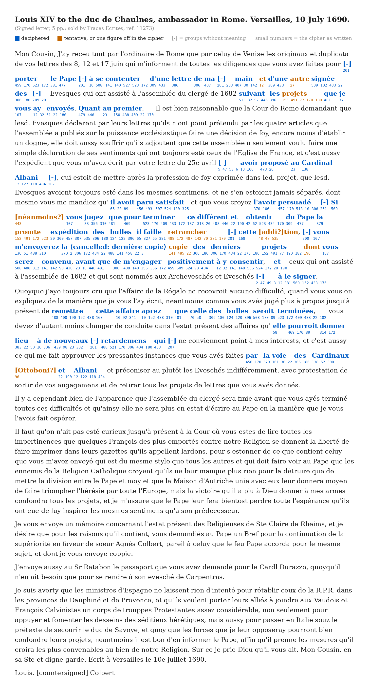
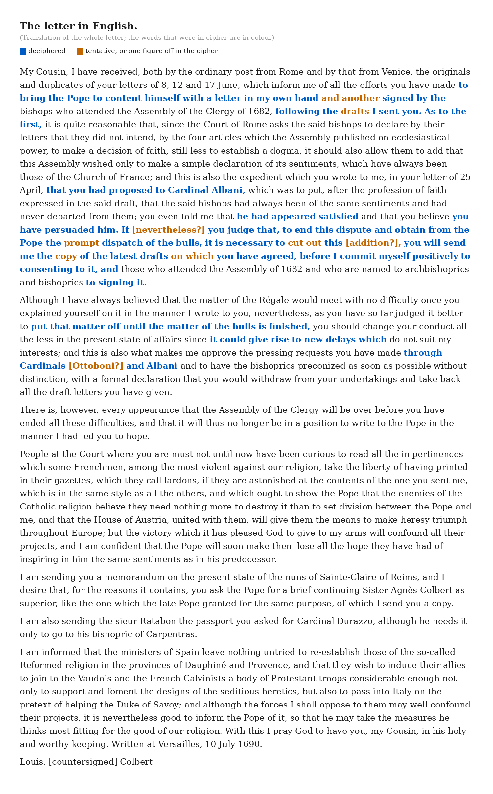
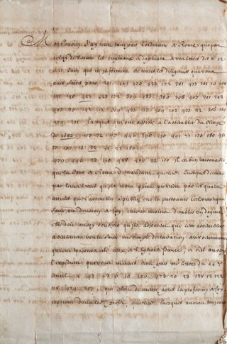
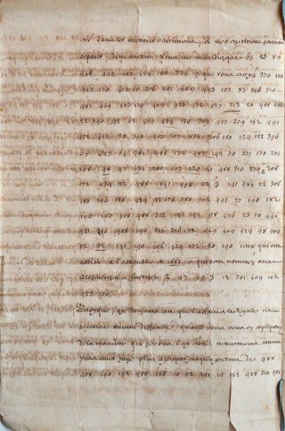
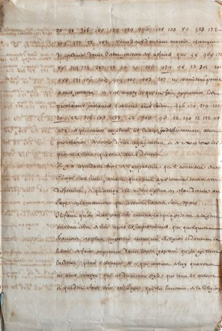
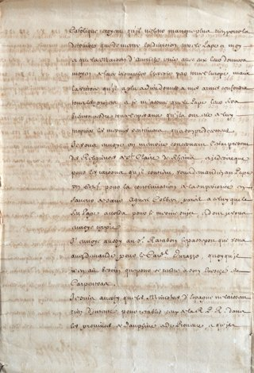
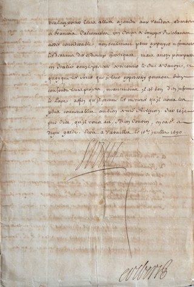

# Louis XIV to the duc de Chaulnes, 10 July 1690 (first known solution)

Jason Benham, November 20, 2026. Deciphered with the assistance of Claude (Anthropic).

**Status: first known solution.** The code has been broken and its layout recovered. All the cipher passages read as
continuous French. Still open: one word (*cette …tion*), one cardinal's name and one connective, which are tentative; and four
words each contain one figure that differs from the key.

## The letter

A five-page letter signed by Louis XIV and countersigned by Colbert de Croissy, his foreign secretary, written at Versailles
on 10 July 1690 to Charles d'Albert d'Ailly, duc de Chaulnes, ambassador extraordinary in Rome. It answers Chaulnes's
despatches of 8, 12 and 17 June. Chaulnes was negotiating with Pope Alexander VIII for the bulls that Rome had refused, since
1682, to the bishops Louis XIV had named from among the clergy who took part in the Assembly of 1682 and its four Gallican
articles. About 300 cipher groups are set into the plain French of the first three pages.

The letter was sold by the Paris autograph dealer Traces Écrites (ref. 11273), whose page gives a transcription and says of the
cipher "le code n'a toujours pas été cassé, à ce jour". Klaus Schmeh published photographs of all five pages as a challenge on
31 January 2019; nobody in the discussion there produced a reading. Satoshi Tomokiyo's Cryptiana describes it (*French Ciphers
during the Reign of Louis XIV*, section 4B) with the words "The letter, partly in cipher, has not been deciphered", and lists
it among unsolved historical ciphers. Links are in [`sources/`](sources/README.md).

## What the letter says

**Background.** A papal *bull* is a formal document from the Pope, named after the lead seal (*bulla*) attached to it. A man
whom the King named as bishop could not take up his office until the Pope issued the bulls confirming him. From 1682 the
Popes refused those bulls to anyone who had sat in the Assembly of the Clergy of that year, which had declared the limits of
papal power in four articles. By 1688 thirty-five French dioceses had no bishop confirmed by Rome, the figure usually given, and by 1692 more than forty
(the latter from "Lorenzo Casoni and papal policy for the Church in France, 1682–1689", *Journal of Ecclesiastical History*). Rome wanted the bishops concerned to
write a letter taking back what the Assembly had done; the argument was over its wording. The *Régale* was a separate quarrel,
over the King's claim to the income of vacant bishoprics. To *preconize* a bishop is to announce his nomination formally in
Rome, the step before the bulls.

**The cipher passages**, which hold the King's negotiating position, say this:

1. The King approves Chaulnes's efforts to bring the Pope to accept a letter in the King's own hand and another signed by the
   bishops, following drafts the King had sent.
2. He recalls that Chaulnes had proposed a form of words to Cardinal Albani, that the Pope (or the Cardinal) had seemed
   satisfied, and that Chaulnes thought he had persuaded him.
3. If Chaulnes nevertheless judges that a phrase must be cut out to end the dispute and get the bulls issued quickly, he is to
   send the final drafts to Versailles first. The King will not commit himself to accepting them, nor the bishops to signing,
   until he has seen them.
4. The Régale question is to wait until the bulls are settled, because raising it now could cause new delays.
5. The King approves the approaches Chaulnes has made through two cardinals, one of them Albani.

What was put into cipher, then, is how far the King was prepared to give way, and through whom he was working at the papal
court.

## The decipherment

Blue = deciphered; orange = tentative, or one figure differs from the key; small numbers = the cipher as written.

## The letter in English

The whole letter translated, with the words that were in cipher in the same colours. The cipher numbers are not repeated
here, because English word order does not follow the French; they are under the French words in the first image.

## How the code is built

Numbers run from 1 to about 535, as if written in rows of ten.

1. **Single letters** stand in the cells ending in 0 and 2, two numbers for each letter, one row per letter, in the order
   a e i o u b c d f g h l m n p q r s t:

   | a | e | i/y | o | u/v | b | c | d | f | g | h | l | m | n | p | q | r | s | t | x | z |
   |---|---|---|---|---|---|---|---|---|---|---|---|---|---|---|---|---|---|---|---|---|
   | 10 12 | 20 22 | 30 32 | 40 42 | 50 52 | 60 62 | 70 72 | 80 82 | 90 92 | 100 102 | 110 112 | 120 122 | 130 132 | 140 142 | 150 152 | 160 162 | 170 172 | 180 182 | 190 192 | 300 302 | 310 312 |

   Not every one of these numbers occurs in the letter; those that do are marked in `key.md`.

2. **Syllables and words** fill every other cell, in one alphabetical list that follows the same letter order (entries
   beginning with a vowel first, then b, c, d … t) and simply steps over the letter cells:

   | | a | e | i | o | u | words read |
   |---|---|---|---|---|---|---|
   | (vowels) | | | | | | 23 *au*, 27 *autre*?, 51 *envoy-*, 58 *elle*, 65 *il*, 77 *je*, 83 *jug-*, 89 *-oit* |
   | v | 97 | 98 | (99) | 101 | (103) | 106 *voir*, 107 *vous* |
   | b | 118 | (119) | (121) | (123) | 124 | |
   | c | | 137 | | 141 | | 138 *cardinal*, 168 *cette*, 196 *dont*? |
   | d | (305) | 306 | 307 | (308) | 309 | 313 *diff-*, 314 *donne* |
   | f | 327 | | | | | 325 *fait*, 341 *faire* |
   | g | 355 | 356 | | | | |
   | h | | 371 | | | | |
   | l | 379 | 381 | 383 | | | 370 *la*, 386 *lettre*, 396 *les* |
   | m | 407 | 408 | 409 | | | 404 *-ment* |
   | n | | 433 | 434 | | 436 | 439 *nou*, 446 *-nt* |
   | p | 456 | 457 | 458 | 459 | | 469 *pour*, 473 *propos-*, 477 *Pape* |
   | qu | 479 | 481 | 483 | | | |
   | r | 487 | 488 | | 491 | 493 | |
   | s | 507 | 508 | 509 | | 513 | 506 *sen* |
   | t | 521 | 523 | 524 | | | 527 *ten*, 535 *-tion* |

   Numbers in brackets are predicted by the rule but do not occur in this letter.

3. **Groups without meaning.** 200–209 are nulls; they open and close several passages. The pairs 2 … 3 and 5 … 6 work as
   brackets round groups to be ignored: twice they enclose two filler groups at the start of a passage, and once, squeezed in
   afterwards with small x-marks, they cancel a false start (*dernière copie*) that the cipher clerk then wrote again correctly.

4. 211–299 are not used at all in this letter (probably names and titles that it did not need).

Every number in the letter, with its value, the words it occurs in and a confidence grade, is in [`key.md`](key.md).

## How it was found, and why it can be trusted

- **Corrected text first.** The published transcriptions were checked against the photographs. Ten groups were wrong in them
  (listed in [`sources/`](sources/README.md)), enough to hide several repeated words.
- **Letters.** 22 is the commonest low number and is followed again and again by 170, 180 or 190, twice at the end of a
  sentence. That is *e* followed by *r*, *s*, *t*, three letters in three consecutive rows of ten, and it gives the rule in
  point 1. The rule then placed *b* at 62 and *g* at 102 before any word needed them.
- **First words.** With the letters in place, *et o-b-?-?-r* could only be *et obtenir*, *?-g-?-e des Evesques* was *signée
  des Evesques*, and *de ?-?-t-t-?* with the same group at both ends was *de remettre*. These gave *te*, *ni*, *si*, *ne*,
  *re*, *me*, all in alphabetical order by number.
- **Prediction.** If the syllables run in order and skip the cells ending in 0 and 2, then *ro* must be 491 and *ru* 493 (not
  490 and 491), *ta* 521, *su* 513, *li* 383 and *qui* 483. Those values, fixed by the rule and not chosen to fit, turn the
  remaining groups into *projets*, *paru satisfait*, *retardemens*, *persuadé*, *suivant*, *donner lieu* and *qui ne
  conviennent*. A wrong rule would have no reason to do that.
- **Sense.** The result is grammatical French that joins the surrounding plain text without a seam, and it agrees with the
  history: Albani and Ottoboni were the cardinals closest to Alexander VIII, and the plain text itself later speaks of
  "tous les projets de lettres que vous avés donnés".

The search was guided by Tomokiyo's reconstruction of the related code Louis XIV used with his ambassador at Constantinople
in the same months (Cryptiana, *Louis XIV's Code/Cipher (1690, 1693)*): letters in low numbers, syllables in alphabetical
order. The Rome code turned out to be laid out differently, but that description was the right place to start.

## What is still open

- *cette [48 47]-tion*, the thing that may have to be cut out. *Addition* suits the sense (the plain text speaks of what the
  bishops "adjoutent"), but the two groups are not confirmed elsewhere.
- Group 96, a cardinal named together with Albani. Its place in the list (late among the vowel entries) and the context
  suggest Ottoboni, the Pope's nephew. Not confirmed.
- Group 443, read as *néanmoins* from the sense alone.
- 27 *autre*, 196 *dont* and 370 *la* each rest on context in one or two places.
- Four words where the figure, as read from the photographs, is one digit away from what the word needs: *proje[170]s*
  (190 = t expected), *pro[172]te* (132 = m; Tomokiyo reads 132 here), *re[172]rancher* (192 = t), *co[485]e* (458 = pi).
  They may be the clerk's slips or misreadings of 7, 9 and 3 in a hand where those figures are alike. One group in the first
  passage is either the number 12 or the plain word *et*; the sense is *et* either way.
- *seroit terminées*: the verb is singular and the participle plural, as written.

## Prior work

No earlier reading was found. Besides the three statements quoted above, Charles Gérin's study of this negotiation, "Le pape
Alexandre VIII et Louis XIV d'après des documents inédits" (*Revue des questions historiques*, 22, 1877), quotes Chaulnes's
despatches of June and July 1690 from the French foreign ministry archives (Correspondance politique, Rome, vols. 331–334) but
not this letter. A plain-text draft of the letter may survive in those volumes. It has not been seen; if it exists it would be
the definitive check on this reading.

**Since publication.** Satoshi Tomokiyo has written up the solution on Cryptiana, ["Solution of Louis XIV's Syllabic Cipher to
Duke of Chaulnes"](https://cryptiana.web.fc2.com/code/louisxiv_chaulnes.htm), with a visualization of the full key. He agrees
with the reading and notes that x and z are provisional.

## The original letter

The five pages of the letter, from the photographs published by the dealer and by Klaus Schmeh (see `sources/`). Click a page
to see it full size. The cipher is on pages 1 to 3; pages 4 and 5 are plain text, ending with the king's signature and
Colbert de Croissy's countersignature.

## Files

- `ciphertext.txt`: the 301 cipher groups in order.
- `letter-annotated.txt`: the whole letter with each cipher word marked, and the English translation of the whole letter.
- `key.md`: every number used, its value, where it occurs and how sure it is.
- `images/`: the letter in French and in English, drawn with the deciphered text in colour.
- `sources/`: the photographs of the five pages, where they and the transcriptions come from, and the readings corrected
  from them.
- `scripts/build_entry.py`: the letter word by word with the value of every group; writes the three text files above and
  checks them against each other. `scripts/render_letters.py`: draws the images.
