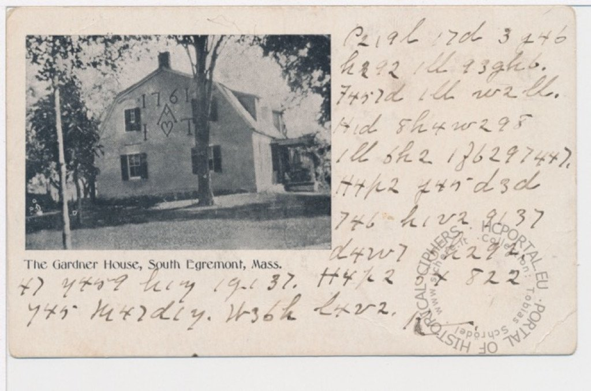
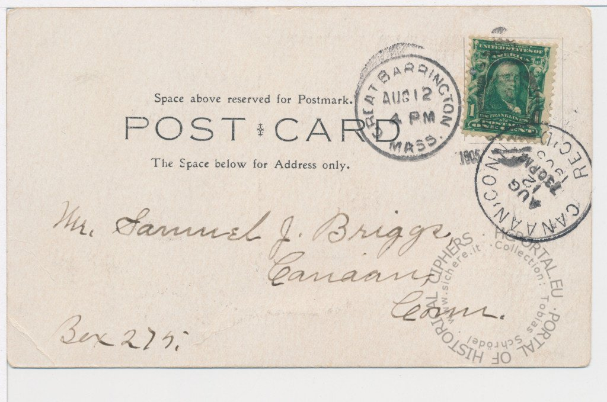

# Postcard from Great Barrington, Mass., to Canaan, Conn., 12 August 1905 (first known solution)

Jason Benham, November 22, 2026. Deciphered with the assistance of Claude (Anthropic).

**Status: first known solution.** HCPortal lists the card as "Not solved" and tags it as shorthand. It is a simple
letter cipher in which nine common letters are replaced by figures.

## The card

A picture postcard of "The Gardner House, South Egremont, Mass." (dated 1761 on its gable), from Tobias Schrödel's
collection of cryptographic postcards. It is addressed in ordinary writing to **Mr. Samuel J. Briggs, Canaan, Conn.,
Box 275**, with a one-cent Franklin stamp. It is postmarked Great Barrington, Mass., 12 August 1905, 4 P.M., and
received at Canaan, Conn., the same evening (7:30 P.M.). The message is written in ink on the picture side, in twelve
short lines.

HCPortal record 1092: https://crypto.hcportal.eu/dashboard/cryptograms/1092

## What it says

> Pearl and I got here all right. Found all well. Had showers all the afternoon. Hope you did not have rain down here
> on your hay again. Hope to see you Monday. With Love.

The writer and Pearl have arrived safely, and the writer hopes the rain held off from Samuel Briggs's hay. The card
was posted at 4 P.M. and delivered in Canaan by 7:30 the same evening; the writer expects to see him on Monday. Haying in
August fits a farm in the Housatonic valley. Canaan lies about fifteen miles south of Great Barrington. "down here" is as written; "down there" would fit the geography better, but the word is h-2-9-2.

## The key

| Letter | a | e | i | o | u | t | n | s | r |
|---|---|---|---|---|---|---|---|---|---|
| Sign | 1 | 2 | 3 | 4 or + | 5 | 6 | 7 | 8 | 9 |

Every other letter is written as itself. The vowels take 1 to 5 in order, and 6 to 9 go to t, n, s, r. More in
[`key.md`](key.md). The card line by line, cipher and reading, is in [`transcription.txt`](transcription.txt).

## How it was found

Because most consonants are left in clear, the message gives itself away once a few words are guessed. The last line,
"W36h L+v2", is "With Love", which gives i = 3, t = 6, e = 2 and o = +. "6h2" is then "the", "P219l 17d" is "Pearl and"
(a = 1, r = 9, n = 7), and "8h4w298" is "showers" (s = 8, o = 4). With those nine signs every word on the card reads
as English, with no exceptions.

## Not certain

- The "6" in "6+ 822" (to see) is faint, partly under the HCPortal watermark.
- The cursive g in "g+6" (got) and "1g137" (again) looks very like the figure 9 (r); context decides each case.

## Files

- `transcription.txt`: the card line by line, cipher and reading.
- `key.md`: the key.
- `sources/card-picture-side.jpg`, `sources/card-address-side.jpg`: the two sides of the card (images supplied by
  Jason Benham from HCPortal, 22 Nov 2026).
- `sources/README.md`: where the card can be seen.

## Prior work

HCPortal lists the card as "Not solved". No reading was found on Klaus Schmeh's blog, where many of Schrödel's
postcards were posted and solved, or elsewhere.
