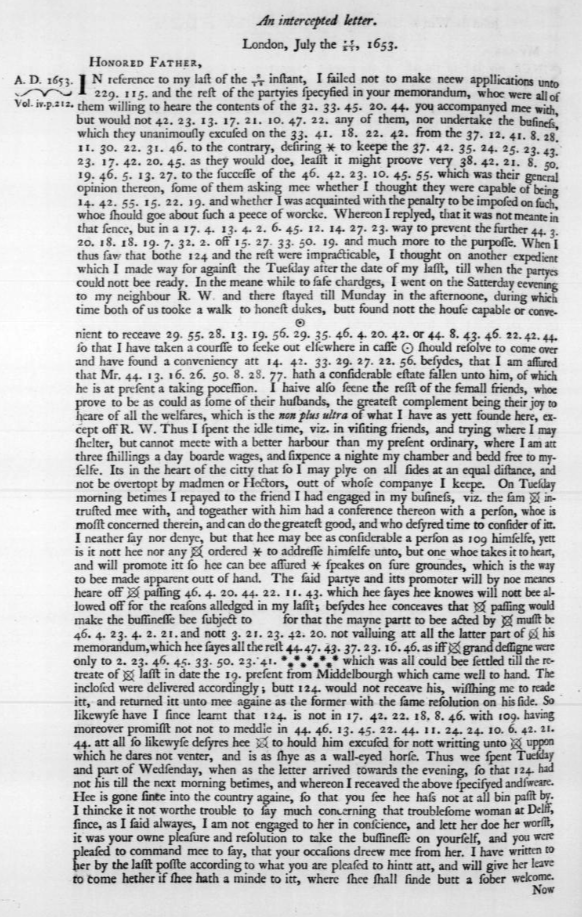
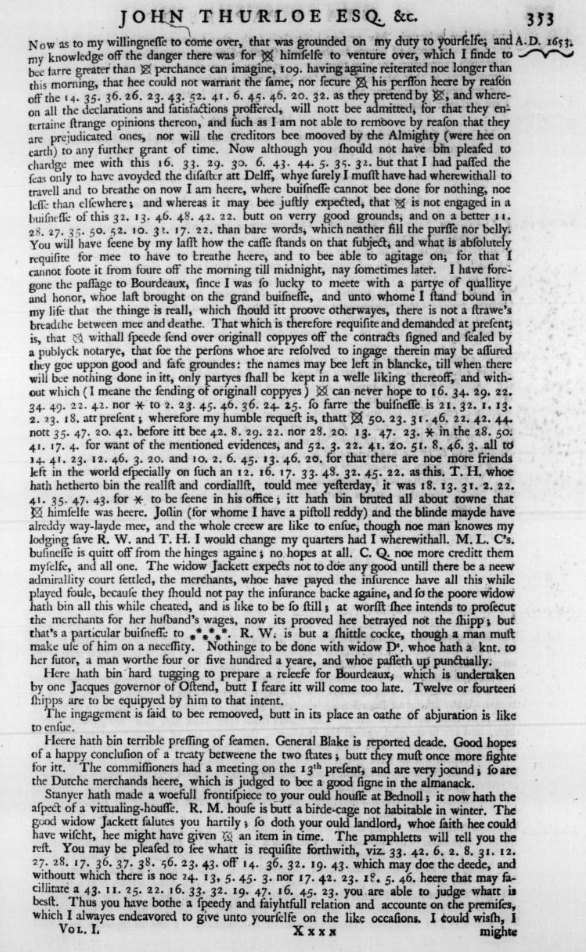
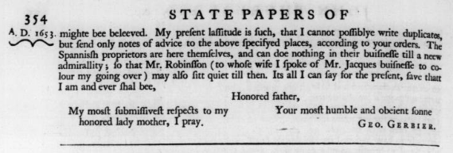
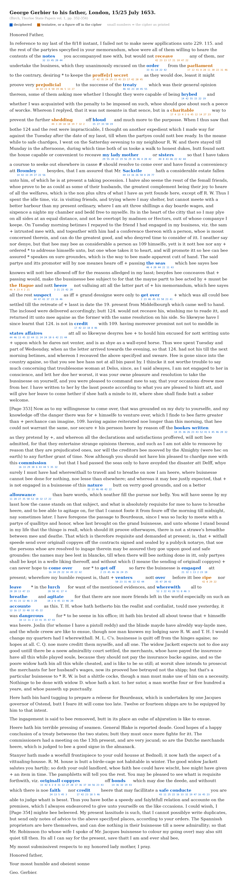

# George Gerbier to his father, 15/25 July 1653 (first known solution)

Jason Benham, November 20, 2026. Deciphered with the assistance of Claude (Anthropic).

**Status: first known solution.** All 44 cipher passages read. The key is a letter cipher with the alphabet in order;
eight words contain a figure or two that the clerk got wrong, and these are marked.

## The letter

An intercepted letter from London, dated 15/25 July 1653 and signed "Geo. Gerbier", to his "Honored Father". Thomas Birch
printed it in *A Collection of the State Papers of John Thurloe*, vol. 1 (London, 1742), pp. 352–354, from the manuscript
volume iv, p. 212, under the heading "An intercepted letter", and left the cipher in figures.

The writer is George Gerbier, a son of Sir Balthazar Gerbier (1592–1663), the courtier, art agent and former
diplomat, who was then living in the Netherlands. The letter fits: it mentions a letter from Middelburg (Balthazar's
birthplace), "your ould housse at Bednoll" (Bethnal Green, where Balthazar had run his academy), "my honored lady mother",
and the family's plans to come over to England.

The letter was written during the First Anglo-Dutch War, while the Dutch commissioners were in London negotiating peace
("Good hopes of a happy conclusion of a treaty betweene the two states; butt they must once more fighte for itt").

## What the letter says

George had been sent to London to put a proposal of his father's to some people named in a memorandum (code numbers
229, 115, 124 and 109 stand for them). The cipher passages carry the sensitive parts:

- They would hear the **notes** he brought but would not **receave** any of them, excusing themselves on the **order from
  the parliament** to the contrary, wanting the **proffer kept secret**, lest it prove **prejudicial** to the success of the
  **treaty**. Some asked whether they were capable of being **bribed**; George answered that it was meant in a **charitable**
  way, to prevent the further **shedding off bloud**.
- He looked for somewhere to receive **my lady mother** or **sisters**, and found a house at **Bromley**. **Mr. Sackvile**
  has come into an estate.
- The people he dealt with would not hear of his father's crossing **the seas**: the main part must be acted at **the
  Hague**, not **heere**. One of them **suspects** that the whole design is only to **get over**; another is not in
  **credit** with 109 and has promised not to meddle in **states affaires**.
- It is not safe for his father to come, "by reason off the **bookes written** as they pretend" by him (Balthazar had just
  published at The Hague a tract on the harm done by bad favourites and ministers of state), and the creditors will give no
  more time.
  George needs money for his **commission**; nothing is done in a business of this **nature** without a better
  **allowance** than words.
- Without original copies of the contracts, signed before a notary, his father can never hope to **come over** nor to **get
  off** his troubles, so far is the business **engaged**. His father must not **venture over** before it is **ripe**, nor
  **leave** George **in the lurch** without the evidences and the means **wherewith** to **breathe** and **agitate**. It is
  **dangerous** to be seen with him. What is needed is **originall coppyes off bonds**, without which there is no **faith**
  or **credit** that could get his father a **safe conducte**.

The cipher hides the political and financial core of the letter: an attempt, during the war, to interest people in London
in a proposal tied to the peace treaty, and the conditions on which Balthazar Gerbier might safely return.

## The printed pages (1742)

## The decipherment

Blue = deciphered; orange = a reading where a figure or two differs from the key, or where the reading is not certain;
small numbers = the cipher as Birch printed it.

## The key

One or more figures for each letter, with the alphabet in order (full table in [`key.md`](key.md)):

| g | h | i | a | b | c | d | e | f | k | l | m | n | o | p | r | s | t | u/v | w | y |
|---|---|---|---|---|---|---|---|---|---|---|---|---|---|---|---|---|---|---|---|---|
| 1 2 | 3 4 | 5–8 | 10–13 | 14 15 | 16 17 | 18 19 | 20–23 | 24 25 | 26 | 27 28 | 29 30 | 31 32 | 33–36 | 37 38 | 41 42 | 43 44 | 45 46 | 47–50 | 51 52 | 55 56 |

The main alphabet runs a to y from 10 to 56, more figures for the common letters; the figures below 10 are extra
homophones for g, h and i. Figure 77 occurs once and stands for e.

## How it was found, and why it can be trusted

- The letter turned up in a sweep of all seven volumes of Birch's Thurloe papers on British History Online, looking for
  letters in which the cipher was printed in figures and not deciphered.
- The cipher passages are words or phrases set into plain English, so the sentence round each one limits what it can be.
  Six were guessed from their context: *notes*, *order*, *parliament*, *treaty*, *state affaires* and *credit*. Together
  they fixed about twenty figures.
- Those values fell into alphabetical order (a 10–13, d 18, e 20–23, n 31–32, r 41–42, s 43–44, t 45–46), which gave the
  rest of the key by position. The remaining passages then read without further guessing: *my lady mother*, *sisters*,
  *Bromley*, *Sackvile*, *bookes written*, *come over*, *gett off*, *in the lurch*, *wherewith*, *breathe*, *agitate*,
  *dangerous*, *originall coppyes off bonds*, *faith*, *safe conducte*.
- A computer search (simulated annealing scored with English letter statistics) on the cipher alone did not converge; with
  the six context words fixed it settled on the same key every run.

## Slips

Eight readings contain a figure that does not match the key, or a letter too many or too few. All read naturally once the
slip is allowed for, and are marked orange:

| Reading | As written | Slip |
|---|---|---|
| receave | r e a c e a u e | extra *a* |
| parliament | p a r i l a m e n t | *l* and *i* exchanged |
| proffe[r] secret | p r o f f e s e c r e t | *r* missing, or "proffe" for "proffer" |
| prejudicial | p r e i u d t i a l | *t* for *c*, *i* missing |
| charitable | c h a h g i t a b l e | *h g* for *r* |
| shedding | s h e d d d i n g | extra *d* |
| the Hague | t h e h g e | *a* missing |
| ripe | r i m e | *m* for *p* |

Two more are spelling, not slips: *gettouer*, *gettoff* ("gett over", "gett off").

The figures 19 and 13 in "the 19. present" and "the 13th present" are dates, not cipher. 229, 115, 124 and 109 are code
numbers for persons and are not read; Birch also printed the signs +, * and # for further names, which are not explained.

## Prior work

No earlier reading was found. Satoshi Tomokiyo's survey of the ciphers in the Thurloe papers ("Codes and Ciphers of
Thurloe's Agents", Cryptiana) does not mention this letter, and web searches for the letter and for George Gerbier in 1653
found no decipherment. The standard biography of Balthazar Gerbier (Lita-Rose Betcherman, *Buckingham's Man*) has not
been checked.

## Files

- `raw_birch.txt`: the letter as Birch printed it, with the cipher in figures (text from British History Online, figures checked
  against the page images).
- `letter-annotated.txt`: the same, with each cipher passage replaced by its reading.
- `ciphertext.txt`: the 44 passages as figures. `key.md`: the key.
- `images/letter-deciphered.png`: the letter with the deciphered words in colour.
- `scripts/build_entry.py`: builds the text files from Birch's text and the readings, and lists every place where a reading
  differs from the key. `scripts/render_letters.py`: draws the image.
- `sources/README.md`: where the printed page can be seen.
