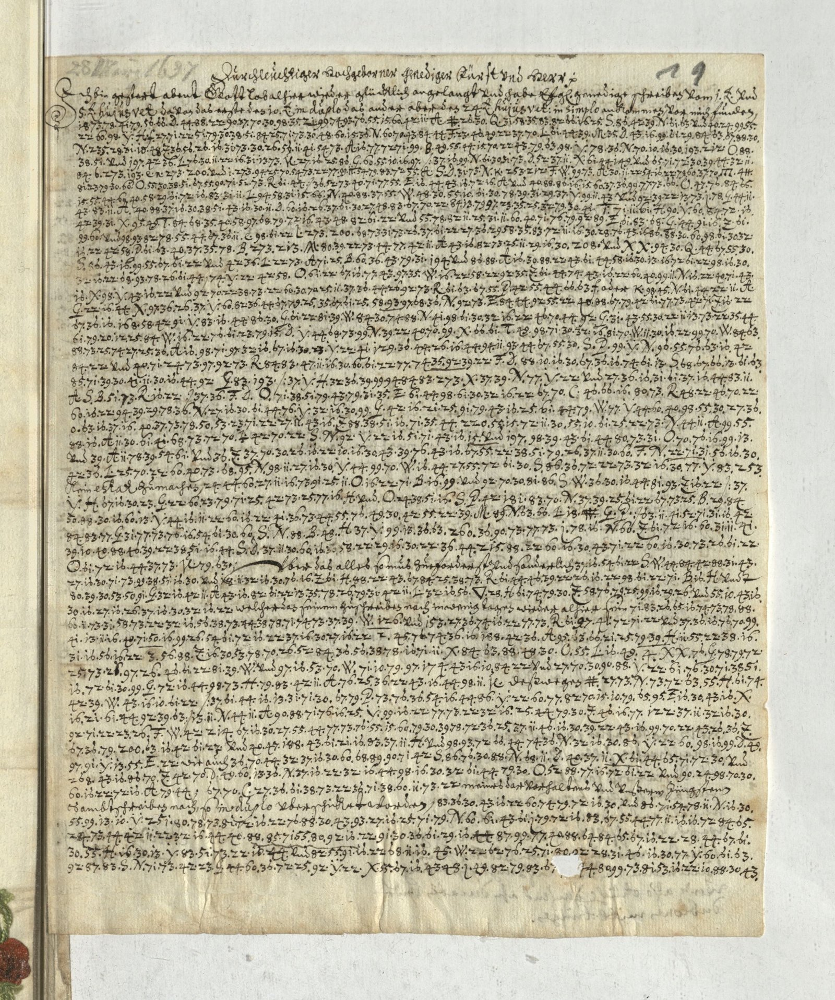
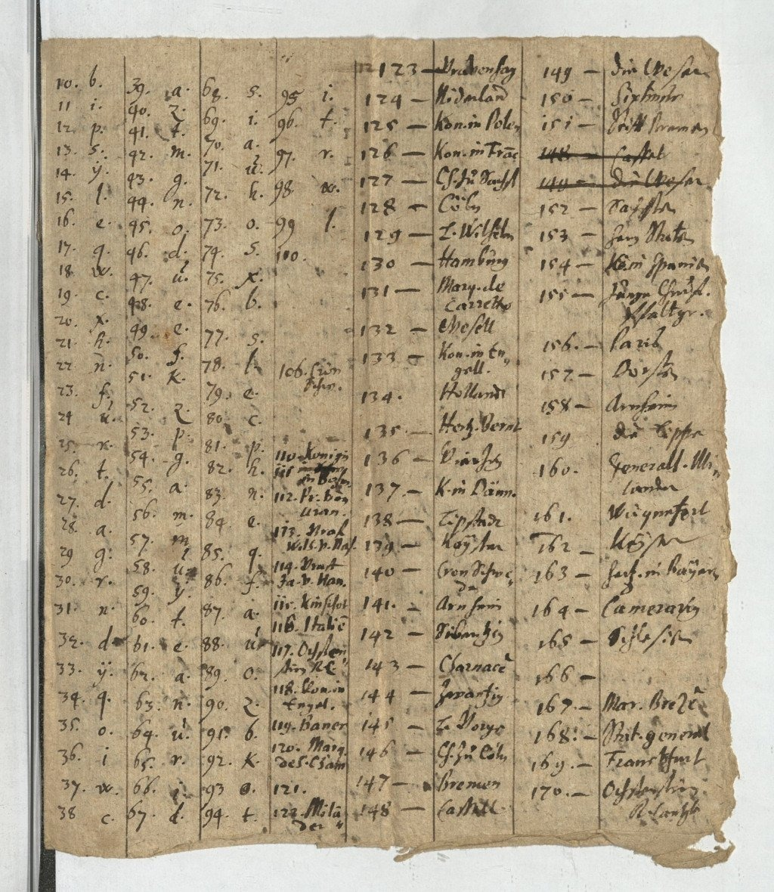

# Otto von der Malsburg to Landgrave Wilhelm V of Hesse-Kassel, January–March 1637 (first known solution, provisional)

Jason Benham, November 23, 2026. Deciphered with the assistance of Claude (Anthropic).

**Status: first known solution, provisional.** The cipher is read with a key that survives in the same archive. The
running text is readable throughout. Some signs, name codes and single misread numbers are still open (see
"Not yet certain").

## The letters

Nine cipher letters (16 page images) in the Hessian State Archive, Marburg, **HStAM 4 h Nr. 1411** (pages 12–33),
written between January and March 1637, at the height of the Thirty Years' War. They are reports from Otto von der
Malsburg, Hessian General Commissary, to Landgrave Wilhelm V of Hesse-Kassel. The first two are dated from Kassel, the
rest from Wesel on the Lower Rhine. Each letter is
ordinary German with long passages in number cipher, about 8,100 cipher numbers in all, plus about 900
capital-letter signs and some three-digit codes.

The letters are records 497–509 in HCPortal (all listed as "Not solved"), for example
https://crypto.hcportal.eu/dashboard/cryptograms/497 .

| Scan | Letter |
|---|---|
| p01 | Outer address side, docket "den 13. Januarij 1637 Cassell" (no cipher) |
| p02 | Kassel, 17/7 January 1637 |
| p03 | Kassel, 16/26 January 1637 |
| p04 | Letter of early 1637 (one cipher block) |
| p05 | Wesel, 30 January / 9 February 1637 (with plaintext lists of officers) |
| p06 | Outer address side of a letter to the Landgrave at Kassel (no cipher) |
| p07 | Wesel, 14/24 February 1637 |
| p08–p09 | Wesel, 7/17 February 1637 |
| p10 | Wesel, 5 March / 23 February 1637 |
| p11–p12 | 28 March 1637 (master copy) |
| p13–p14 | 28 March 1637, "Duplicat" (second copy of p11–p12) |
| p15 | French letter of April 1637 with cipher, and German extracts of newsletters |
| p16 | Extracts (continued) |

## The key

The key is **HStAM 4 d Nr. 1218, fol. 118** (HCPortal cipher key 29, dated "1641 or before"), in the Hessian
chancellery's collection of cipher keys. It is a deciphering table: the numbers 10–99, each with its letter, and a list
of name codes from 110 to 170.

Letters (from the key; u also stands for v, i for j):

| a | b | c | d | e | f | g | h | i | k | l | m |
|---|---|---|---|---|---|---|---|---|---|---|---|
| 28 39 55 62 70 87 | 10 76 91 | 19 38 80 | 27 32 46 67 | 16 48 49 61 79 84 | 23 50 86 | 29 43 54 | 21 72 82 | 11 36 66 69 95 | 51 92 | 15 78 99 | 42 56 57 |

| n | o | p | q | r | s | t | u | w | x | y | z |
|---|---|---|---|---|---|---|---|---|---|---|---|
| 22 31 44 63 83 | 35 45 73 89 93 | 12 53 81 | 17 34 85 | 25 30 65 97 | 13 68 74 77 | 26 41 60 94 96 | 24 47 58 64 71 88 | 18 37 98 | 20 75 | 14 33 59 | 40 52 90 |

The match is not in doubt. The rare letters q, x and y sit on 14, 17, 20, 33, 34, 59 and 75, the numbers that almost
never occur in the letters. With the key, the 8,100 numbers turn into continuous German with no adjustment.

**Capital-letter signs.** The key sheet has no table for the capitals used in the letters. Their values were worked
out from context and stand for common letter groups:

| Sign | Value | Evidence (as deciphered) |
|---|---|---|
| N, D | ch | noCH, naCH, unmögliCH, kurtzliCH |
| W, P | ss | daSS, laSSen, müSSen, wiSSen |
| Z, O | st | iST unmöglich, STatthalter, geSTehen, HermanSTein |
| j, X | sch | geSCHrieben, SCHreiben, SCHwerlich, SCHweden |
| Y, G | ei | kEInen, EInander, HermanstEIn |
| S, F | au | AUf, AUch |
| H | ll | aLLe, woLLen |
| L, A | t(t) | miTbringen, noTwendig, häTTe |
| R, M, E, C | mm | koMMen |
| B, T | f(f) | Brieff, Effect, Graff |

## What it says (samples)

Modern spelling, provisional. [ ] marks a name code or editorial addition.

**Kassel, 17 January 1637.** "I do not yet know how I am to be employed, and whether I shall still be in Kassel or with
the army … It is reported from a good source that it has been resolved at Regensburg to grant the envoys to Cologne
no safe-conduct (*salvum conductum*) … that the Bishop of Würzburg wrote to him in August that if Landgrave Wilhelm,
with the King of Bohemia, but now Roman King, … they might yet obtain a good peace … one would have [the matter]
negotiated separately through the King of Denmark with Hamburg or Lübeck."

The election of Ferdinand III, King of Bohemia, as King of the Romans at Regensburg in December 1636 is exactly what
"König von Böhmen, nunmehr aber dem römischen König" describes.

**Kassel, 26 January 1637.** The cipher reports the provisioning of "Hermanstein" (Ehrenbreitstein, the fortress on
the Rhine opposite Koblenz, then held by a French garrison and under imperial blockade). It also mentions
Lieutenant-Colonel Hoffmann, guns, Marburg, Korbach and Lippstadt, and troops taking "the straight road from Cologne
to Frankfurt"; these passages still need a careful reading.

**28 March 1637.** Malsburg weighs moving troops and artillery down the Rhine: "to go by land is not feasible, by water
slow, and cannot be done so quickly, for it takes much time before one gets ships that can go to sea, which are not
to be had here … new twelve-pounder guns … a free pass would have to be requested, for no garrison will let ships
pass without express orders; thirdly the enemy would easily guess Landgrave Wilhelm's intention from it". He then
lists questions for the French: what the King of France will do this summer and how soon they will take the field;
whether they will take [the Landgrave] into their alliance; whether they will allow a mustering place in the duchy
of Cleves; and whether they will grant passage back and forth over [a river] and lend a bridge for it.

The full text is in [`decipherment/letters.txt`](decipherment/letters.txt) (letter by letter) and
[`decipherment/words.txt`](decipherment/words.txt) (split into words by computer, roughly).

## How it was found

1. The 16 page images (supplied by Jason Benham from HCPortal at full resolution) were transcribed number by number;
   about 8,100 cipher numbers.
2. Statistics showed two-digit numbers standing for letters, with several numbers per letter, but a homophonic solver
   would not converge. The capital-letter signs, it turned out, stand for letter groups, not letters.
3. HCPortal also holds the Hessian chancellery's cipher keys from the same years. Their structure was compared with
   the letters. Key 29 is the only one whose rarely used numbers line up with the letters' rare numbers, and it turns
   the numbers into German at once.
4. The capital-letter signs were then read from context.

## Not yet certain

- **Capital-letter values** are inferred, not from a key. The rarer signs (#, XX, Q, K, V, I, TRI, GG) are not
  identified. Sheets 119–120 of the same file may hold the official table.
- **Name codes above 170**, and some below, are not on the key sheet. The most frequent (273, 188, 193, 212, 200, 253)
  often stand next to numbers and may be numerals or units ("thousand", "men", "horse", "pieces"). The bracketed
  names in the decipherment are read from the key and some are uncertain.
- **Misread numbers.** An independent check of part of the duplicate copy against the master copy showed 5–7%
  disagreement between the two readings, some of it the clerk's own copying errors. They appear as single wrong
  letters in the German.
- **Word division** in `words.txt` is by computer and often wrong; it is only a reading aid.

## Prior work

HCPortal lists all nine letters as "Not solved". No decipherment was found elsewhere.

## Files

- `scans/`: the 16 page images (reduced in size), in the order listed above.
- `transcription/`: the cipher, page by page, as transcribed; plaintext passages between `| |`.
- `key/`: the key sheet, HStAM 4 d Nr. 1218 fol. 118.
- `decipherment/letters.txt`: the deciphered text, letter by letter.
- `decipherment/words.txt`: the same, split into words by computer.
- `scripts/`: the key as data (`key29.py`) and the scripts used to read and split the text.

## Sources

- Hessisches Staatsarchiv Marburg, HStAM 4 h Nr. 1411 (the letters) and 4 d Nr. 1218 (cipher keys).
- HCPortal, records 497–509 and cipher key 29: https://crypto.hcportal.eu/
