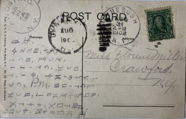
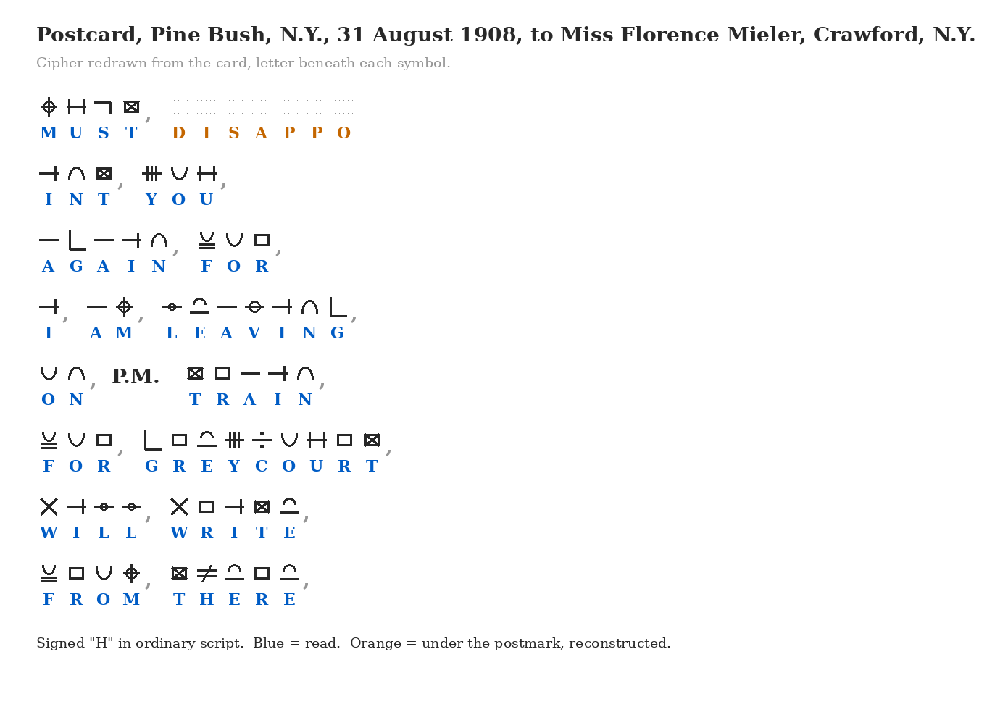

# Postcard from Pine Bush, N.Y., to Miss Florence Mieler, 31 August 1908 (first known solution)

Jason Benham, November 22, 2026. Deciphered with the assistance of Claude (Anthropic).

**Status: first known solution.** Every symbol on the card is read except one word partly covered by a postmark, which
is reconstructed from the letters around it. HCPortal lists the card as "Not solved".

## The card

A picture postcard ("On The Bend, Pine Bush, N. Y.", published by A. R. Armstrong, Pine Bush, No. 11, made in Germany),
addressed in ordinary writing to Miss Florence Mieler, Crawford, N.Y. It carries a one-cent Franklin stamp and is
postmarked Pine Bush, N.Y., 31 August 1908, 4 P.M., with a second postmark over the message. The message, eight
lines on the left half, is written in a homemade alphabet of symbols, with a comma after every word. "P.M." is written
in ordinary letters, and the card is signed "H" in ordinary script.

The card is record 55 in HCPortal, an online database of historical cryptograms and cipher keys: https://crypto.hcportal.eu/dashboard/cryptograms/55 (Substitution / Monoalphabetic, private
collection). The image is on the record's Attachments tab.

## What it says

> MUST [DISAPPO]INT YOU AGAIN, FOR I AM LEAVING ON [the] P.M. TRAIN FOR GREYCOURT. WILL WRITE FROM THERE. H.

"Must disappoint you again, for I am leaving on the P.M. train for Greycourt. Will write from there." H. is cancelling
a meeting, apparently not for the first time, because he or she is taking the afternoon train.

Greycourt was the railway junction near Chester, Orange County, where the Erie Railroad's main line met its Newburgh
branch and the Lehigh & Hudson River Railway, with a station, freight house and two hotels. Pine Bush and Crawford are
about twenty-five miles to the north-west, in the same part of the Hudson Valley, so a train from Pine Bush to Greycourt is
an ordinary local journey.

No hour is written before "P.M." in cipher; the writer may have meant "the P.M. train" (the afternoon train), or the hour
was left out.

## The decipherment

Each symbol is redrawn as it looks on the card, with its letter beneath. Blue = read; orange = under the postmark.

## The key

One symbol per letter, 18 letters seen (full table with descriptions in [`key.md`](key.md)):

| A | C | E | F | G | H | I | L | M | N | O | R | S | T | U | V | W | Y |
|---|---|---|---|---|---|---|---|---|---|---|---|---|---|---|---|---|---|
| – | ÷ | ∩ over – | ∪ over = | ⌞ | ≠ | ⊣ | –o– | ⊕ | ∩ | ∪ | □ | ⌐ | ⊠ | \|–\| | ⊖ | X | ladder |

Some shapes come in families: A, I, U and Y are a dash with 0, 1, 2 and 3 uprights; N and O are the same arch facing down
and up; R and T are the box plain and crossed; L, M and V are circles.

## How it was found, and why it can be trusted

- The card turned up in a search of HCPortal's 346 records marked "Not solved", looking for short messages in English
  with a clear image. This one has a crib in plain sight ("P.M.") and commas between words, so the word lengths are known.
- The symbols were transcribed from the image and given a computer search: simulated annealing over all one-to-one keys,
  scored by how many of the decoded words are common English words, plus English letter statistics. Several runs, from
  different random starts, gave the same core: "AGAIN FOR I AM LEAVING ON P.M. TRAIN FOR … WILL WRITE FROM THERE".
- The rest was read by hand with that key. In "MUST", "YOU", "LEAVING", "WRITE" and "FROM" the first transcription had
  given two different symbols the same label, or missed one; a closer look at the image settled each case.
- The destination has nine symbols, G R E Y C O U R T. Eight are letters already fixed by other words, and the ninth
  (÷ for C) is the only new one. That a place of exactly that name lies on the railway twenty-five miles away is a strong check.
- Every symbol means the same letter wherever it occurs: 18 letters, 65 symbols read, no exceptions.

## Not certain

- **DISAPPO-**: the second word of line 1 is mostly under the second postmark. Line 2 begins with I N T, which is not an
  English word on its own, so the word most likely runs over the line break. "Disappoint you again" fits
  the sense and the visible strokes, but the middle letters cannot be seen, and D and P do not occur elsewhere on the card.
- **The greeting**: a short word or initials before "H." on the top line are not read at the resolution of the image.

## Prior work

HCPortal lists the card as "Not solved", and no reading of it was found elsewhere.

## Files

- `transcription.txt`: the card line by line, each symbol written as its letter.
- `key.md`: the key, with a description of each symbol.
- `images/card-deciphered.png`: the card redrawn with the reading.
- `scripts/render_card.py`: draws the image and counts the letters.
- `sources/postcard-back.jpg`: the back of the card.
- `sources/README.md`: where the card can be seen.
