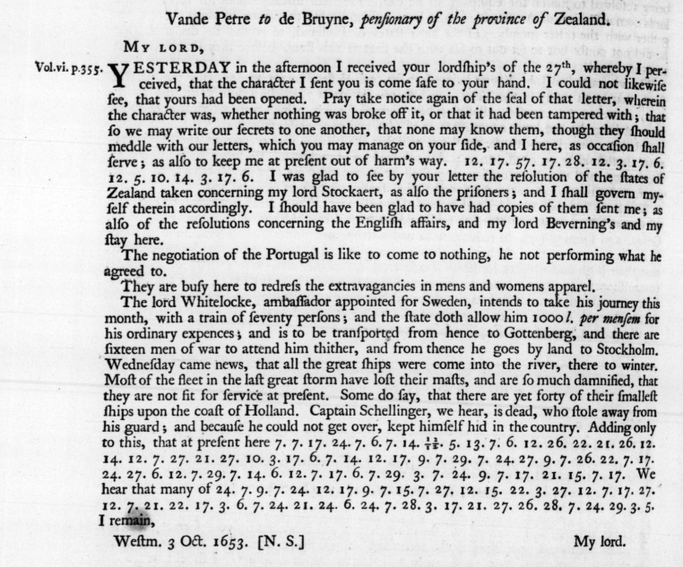
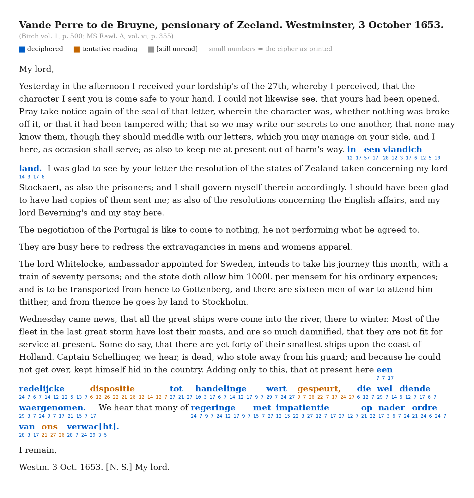
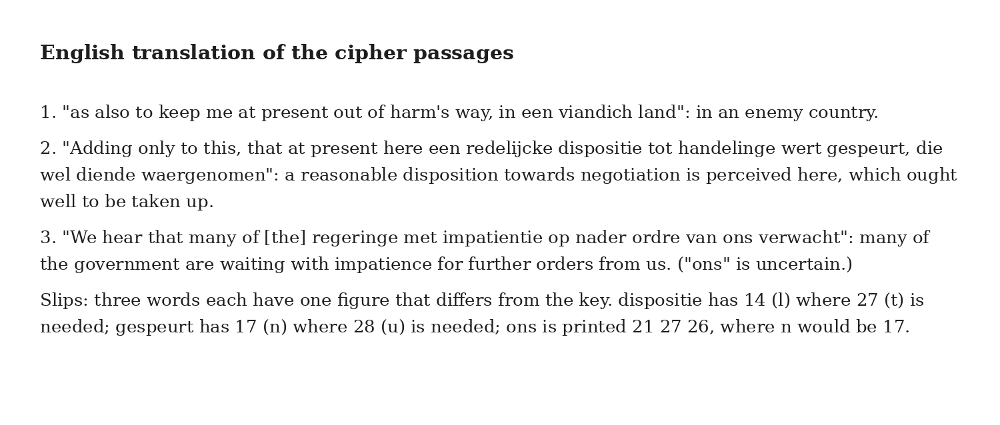

# Vande Perre to de Bruyne, 3 October 1653 (first known solution)

Jason Benham, November 19, 2026. Deciphered with the assistance of Claude (Anthropic).

**Status: first known solution.** The cipher has been broken and the key recovered; all three cipher passages read; three words each contain one figure that differs from the key.

## The letter

Johan van de Perre, one of the Dutch envoys negotiating with Cromwell's government during the First Anglo-Dutch War, writes
from Westminster to de Bruyne, pensionary of the province of Zeeland, on 3 October 1653 (new style). The letter was intercepted
and kept in John Thurloe's papers. Thomas Birch printed it in English translation in *A Collection of the State Papers of John
Thurloe*, vol. 1 (London, 1742), p. 500, with the three cipher passages left in figures. The manuscript reference Birch gives is
Vol. vi, p. 355 (Bodleian, MS. Rawlinson A).

Satoshi Tomokiyo's Cryptiana lists it as undeciphered: its cipher "appears to be different from the above and it remains
undeciphered" ([Table Switching in Dutch Diplomatic Ciphers](https://cryptiana.web.fc2.com/code/dutch1653.htm), section
"Vande Perre and de Bruyne, pensionary of Zeeland").

## The printed page (1742)

## The decipherment

Blue = deciphered; orange = one figure differs from the key; small numbers = the cipher as Birch printed it. The plaintext is
seventeenth-century Dutch: Birch translated the clear parts of the letter into English but left the cipher as it stood.

| After (Birch's English) | Cipher passage, deciphered | Meaning |
|---|---|---|
| "as also to keep me at present out of harm's way." | *in een viandich land* | in an enemy country |
| "Adding only to this, that at present here" | *een redelijcke dispositie tot handelinge wert gespeurt, die wel diende waergenomen* | a reasonable disposition towards negotiation is perceived, which ought well to be taken up |
| "We hear that many of" | *[de] regeringe met impatientie op nader ordre van ons verwac[ht]* | the government are waiting with impatience for further orders from us |

## The key

A simple substitution with the figures in alphabetical order, with gaps:

| a | c | d | e | g | h | i/j/y | k | l | m | n | o | p | r | s | t | u/v | w |
|---|---|---|---|---|---|---|---|---|---|---|---|---|---|---|---|---|---|
| 3 | 5 | 6 | 7 | 9 | 10 | 12 | 13 | 14 | 15 | 17 | 21 | 22 | 24 | 26 | 27 | 28 | 29 |

57 occurs once, in *een* (57 17), and appears to stand for the doubled vowel *ee* (elsewhere *een* is written 7 7 17).
That also settles a suggestion recorded on Cryptiana that "7 7" might be W: it is the *ee* of *een*.

## How it was found, and why it can be trusted

- The 134 figures (19 distinct) were given to a simulated-annealing solver for one-to-one substitution, scored with Dutch
  5-gram statistics, with 24 random restarts and nothing else assumed. All the best runs converged on the same key
  ([`scripts/solve_mono.py`](scripts/solve_mono.py)).
- The recovered key runs in alphabetical order (a = 3, c = 5, d = 6, e = 7 … w = 29). The solver did not assume this; a wrong
  key would have no reason to come out ordered.
- The readings fit the clear text exactly: an envoy in London at war "out of harm's way, in an enemy country", and a confidential
  note that the English seemed ready to negotiate.

## Slips

Three words each have one figure that does not match the key. They read naturally with the expected letter, so they look like
the encipherer's or the printer's errors:

- *dispositie*: 14 (l) where 27 (t) is needed.
- *gespeurt*: 17 (n) where 28 (u) is needed.
- *ons*: printed 21 27 26 (o t s), where *ons* needs 17 (n) for 27. This word is the least certain.

The last passage ends at *verwac*, presumably *verwacht*, as printed.

## Prior work

A web search for the Dutch plaintext found no earlier reading. The printed Dutch editions of the envoys' correspondence (where
Paolo Rosson found the plaintext of the Beverning–Vande Perre letter to Boreel) have not been checked for this letter.

## Files

- `ciphertext.txt`: the three passages as figures.
- `letter-annotated.txt`: the full letter, from Birch, with each cipher word marked.
- `images/`: the letter and translation drawn with the deciphered text in colour.
- `sources/`: the printed page (Birch vol. 1, p. 500).
- `scripts/solve_mono.py`: the substitution solver; `scripts/render_letters.py`: draws the images.
