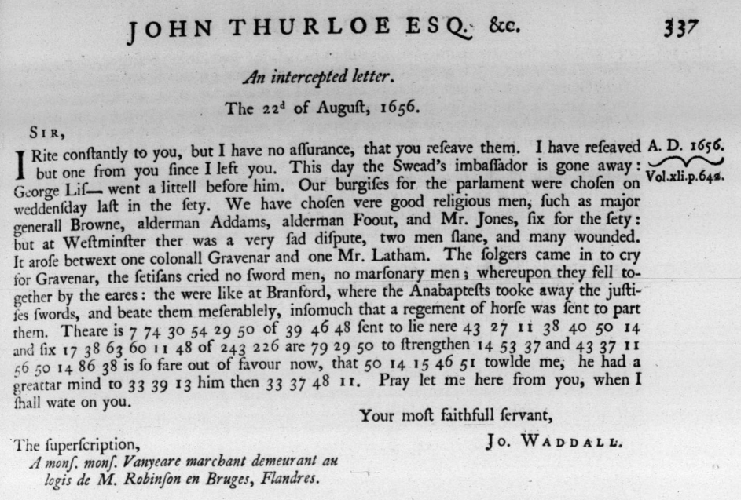
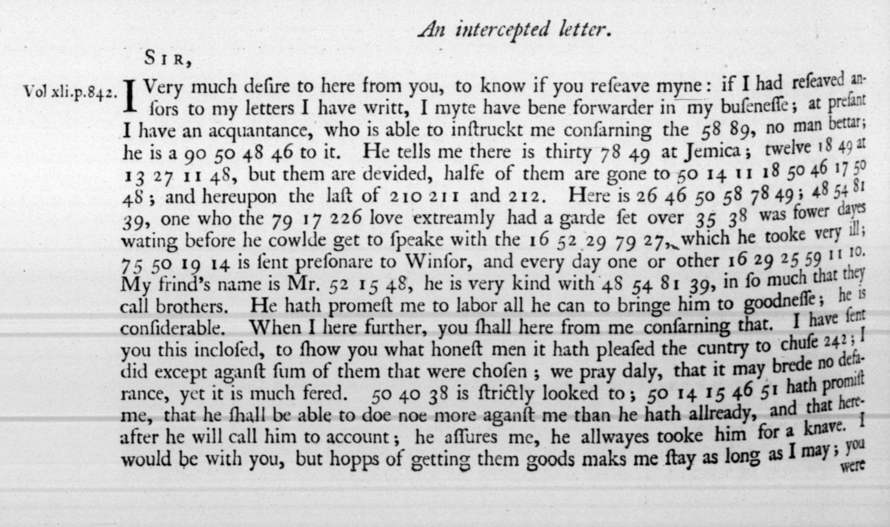
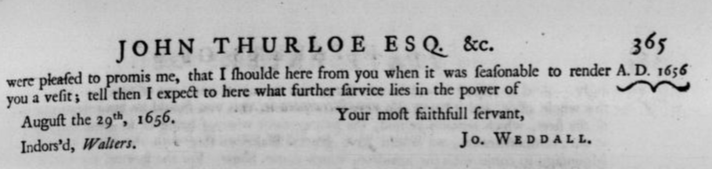
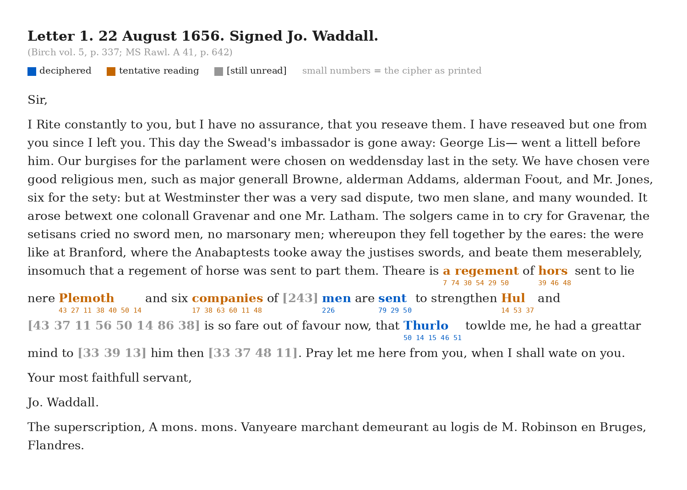
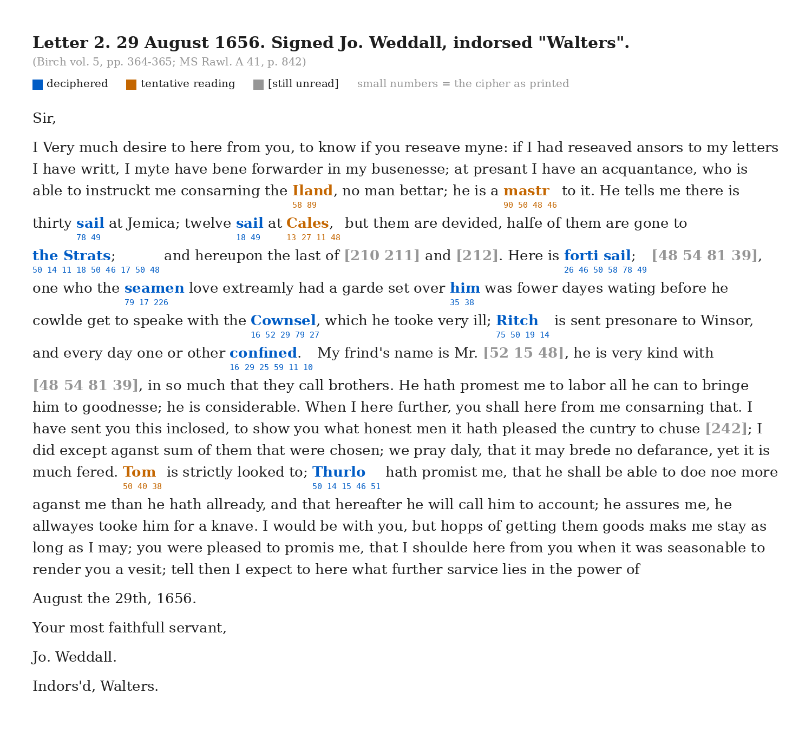

# The John Walters cipher letters, August 1656 (partial decipherment)

Jason Benham, November 19, 2026.

**Status: partially deciphered.** Most of the cipher text now reads; three names, two verbs and five code numbers are still open.

## The letters

Two letters printed as "An intercepted letter" in Thomas Birch (ed.), *A Collection of the State Papers of John Thurloe*,
vol. 5 (London, 1742), with their cipher passages left as bare numbers:

| Date | Signed | Printed | Manuscript |
|---|---|---|---|
| 22 Aug 1656 | Jo. Waddall | p. 337 | Bodleian, MS. Rawlinson A. 41, p. 642 |
| 29 Aug 1656 | Jo. Weddall (indorsed "Walters") | pp. 364–365 | Bodleian, MS. Rawlinson A. 41, p. 842 |

The first is addressed to "Mons. Vanyeare marchant", lodging at M. Robinson's house in Bruges, where Charles II's exiled
court was. Page scans are in [`sources/`](sources/), and the full transcription with the cipher groups marked is in
[`transcription.txt`](transcription.txt).

## The printed pages (1742)

Page scans from the Internet Archive copy of Birch, vol. 5. These are the source the decipherment works from.

**Letter 1, p. 337**

**Letter 2, pp. 364–365**

## The full letters, deciphered

Both letters written out in full. Text in **blue** is deciphered with numbers that are confirmed in other words, **orange** is
a tentative reading (it relies on numbers that occur only once, or on an assumed misprint), and **grey [numbers]** are still
unread. The small numbers under each coloured word are the cipher as printed in 1742.

The text behind these images, with the same markup, is in [`letters-annotated.txt`](letters-annotated.txt); the images are
drawn from it by `scripts/render_letters.py`.

## The writer

The writer is John Walters, brother of the Yorkshire royalist agent Robert Walters. David Underdown, *Royalist Conspiracy in
England, 1649–1660* (1960), pp. 174–175, describes him as one of Thurloe's paid informers inside the royalist network: in April
1656 he let Thurloe's officer copy a letter from the King to Sir Henry Slingsby before delivering it, and Underdown says
Thurloe's employment of him "evidently came to an end in August 1656", the month of these two letters. Underdown (p. 319) also
notes that Walters was never unmasked.

Underdown's note 30 (p. 175) mentions "some obscure letters from Walters, under the pseudonym 'Weddall'" at these two places
in the Thurloe papers, without reading them. The 1742 editor printed them without a decipherment, and no published
decipherment has been found.

## The cipher

The numbers below 100 stand for single letters **and** consonant–vowel syllables (a small syllabary), which is why few numbers
repeat. Numbers above 200 are code words for names or terms.

Some letters also have more than one number (homophones), a standard way of flattening letter frequencies. For example, *s* can
be written 18, 48 or 78: "sail" appears as `78 49` and again as `18 49` in the same letter, and 18 = s is independently
confirmed in "the Strats" (`50 14 11 18 50 46 17 50 48`).

The key observation: earlier in the first letter, in clear, Walters writes "a regement of horse". The first cipher group,
`7 74 30 54 29 50 of 39 46 48`, reads *a-re-ge-me-n-t of ho-r-s*, one value per number, and those values then produce real
words in the other groups.

### Values recovered

| No. | Value | No. | Value | No. | Value | No. | Value |
|---|---|---|---|---|---|---|---|
| 7 | a | 25 | f | 43 | p (or f) | 58 | i |
| 10 | d | 26 | fo | 46 | r | 59 | in |
| 11 | e | 27 | l | 48 | s | 60 | ni |
| 13 | ca | 29 | n | 49 | ail | 63 | pa |
| 14 | h | 30 | ge | 50 | t | 74 | re |
| 15 | u | 35 | hi | 51 | lo | 75 | ri |
| 16 | co | 37 | l | 52 | w | 78 | s |
| 17 | a | 38 | m | 53 | u | 79 | se |
| 18 | s | 39 | ho | 54 | me | 86 | o |
| 19 | c | 40 | o | | | 89 | land |
| | | | | | | 90 | ma (?) |

Code word: 226 = men. Unknown code words: 210, 211, 212, 242, 243.

## Readings

Spelling is Walters's own. **Bold** = deciphered; [brackets] = still open.

**22 August 1656:**
> There is **a regement** of **hors** sent to lie near **Plemoth**, and six **companies** of [243] **men** are **sent** to
> strengthen **Hul**, and [**?-le-?-thom**] is so far out of favour now, that **Thurlo** told me he had a greater mind to
> [33 39 13] him than [33 37 48 11].

**29 August 1656:**
> …concerning the **Iland**, no man better; he is a **mastr** to it. He tells me there is thirty **sail** at Jemica; twelve
> **sail** at **Cales**, but them are divided, half of them are gone to **the Strats**; and hereupon the last of [210 211] and
> [212]. Here is **forti sail**; [48 54 81 39], one who the **seamen** love extremely, had a guard set over **him**, was four days
> waiting before he could get to speak with the **Cownsel**, which he took very ill; **Ritch** is sent prisoner to Winsor, and
> every day one or other **confined**. My friend's name is Mr. [52 15 48] … **Tom** is strictly looked to; **Thurlo** hath
> promist me that he shall be able to do no more against me…

"Cales" is Cadiz, "the Strats" the Straits of Gibraltar, "the Iland" Jamaica.

### Group by group

| Letter | Cipher | Reading | Confidence |
|---|---|---|---|
| 1 | 7 74 30 54 29 50 | a re-ge-me-n-t = a regement (four of the numbers occur only here; supported by "a regement of horse" in clear earlier in the letter) | medium |
| 1 | 39 46 48 | ho-r-s = hors (39 occurs only here) | medium |
| 1 | 43 27 11 38 40 50 14 | p-l-e-m-o-t-h = Plemoth (43 may be f: Flemoth/Falmouth) | medium |
| 1 | 17 38 63 60 11 48 | co-m-pa-ni-e-s = companies, reading 17 as a slip for 16 (17 is clearly printed in 1742) | medium |
| 1 | 243 226 | [code] men | partial |
| 1 | 79 29 50 | se-n-t = sent | high |
| 1 | 14 53 37 | h-u-l = Hul (Hull) | low |
| 1 | 43 37 11 56 50 14 86 38 | ?-l-e-?-t-h-o-m (a name) | open |
| 1 | 50 14 15 46 51 | t-h-u-r-lo = Thurlo | high |
| 1 | 33 39 13 / 33 37 48 11 | two verbs | open |
| 2 | 58 89 | i-land = Iland | medium |
| 2 | 90 50 48 46 | ma-t-s-r = mastr, assuming two numbers swapped | low |
| 2 | 78 49 / 18 49 | s-ail = sail (49 occurs only in this word; "ships" would mean the same) | medium |
| 2 | 13 27 11 48 | ca-l-e-s = Cales | medium |
| 2 | 50 14 11 18 50 46 17 50 48 | t-h-e s-t-r-a-t-s = the Strats | high |
| 2 | 210 211, 212, 242 | code words | open |
| 2 | 26 46 50 58 78 49 | fo-r-t-i s-ail = forti sail | medium |
| 2 | 48 54 81 39 | s-me-?-ho (a name; occurs twice) | open |
| 2 | 79 17 226 | se-a-men = seamen | high |
| 2 | 35 38 | hi-m = him | high |
| 2 | 16 52 29 79 27 | co-w-n-se-l = Cownsel | high |
| 2 | 75 50 19 14 | ri-t-c-h = Ritch (75 and 19 occur only here) | medium |
| 2 | 16 29 25 59 11 10 | co-n-f-in-e-d = confined | high |
| 2 | 52 15 48 | w-u-s (a name) | open |
| 2 | 50 40 38 | t-o-m = Tom | medium |

## Historical fit

- A Thurloe intelligence letter of 26 August 1656 (TSP vol. 5, pp. 316–332) says those raising disturbances were "ordered to be
  proceeded with, as Okey, Lawson, Rich, Ludlowe", matching "Ritch is sent prisoner" and "every day one or other confined".
- The man "the seamen love extremely" ought historically to be Vice-Admiral John Lawson, but `48 54 81 39` does not spell
  Lawson under the current values.
- "Tom", out of favour and "strictly looked to", may be Sir Thomas Fairfax ("Black Tom"), on whom the northern royalists were
  counting; not yet supported by the numbers.

## Open questions and next steps

1. **The manuscript.** Underdown also cites Rawl. MS A 41, pp. 498 and 536, possibly two further letters in this cipher. Scans
   of pp. 498, 536, 642 and 842 would show whether the two assumed slips are printing errors and might supply more text.
2. The three names, the two verbs and the code words 210, 211, 212, 242, 243.

## Files

- `letters-annotated.txt`: both letters in full, each cipher group marked as deciphered, tentative or unread.
- `images/`: the two letters drawn with the deciphered text in colour.
- `transcription.txt`: the cipher passages with their surrounding clear text, cipher groups in brackets.
- `sources/`: page scans of the 1742 edition (Internet Archive).
- `working-notes.md`: the working log, including approaches tried and ruled out (e.g. the Cooper block cipher).
- `scripts/`: the solver used in the first passes, and the script that draws the coloured letters.
